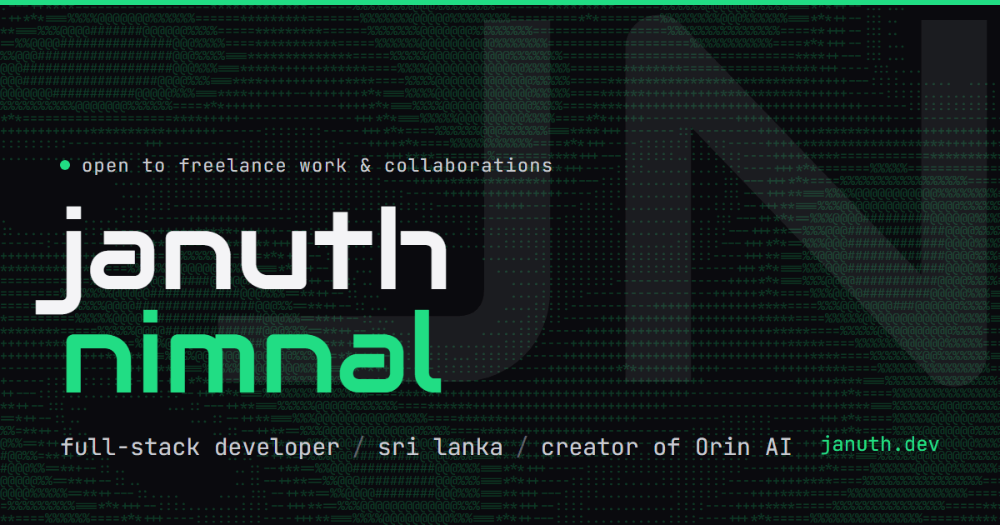

# januth.dev

Personal portfolio of **Januth Nimnal** — full-stack developer, Sri Lanka.
Live at [januth.dev](https://januth.dev).

A cinematic landing page — characters erupt from behind a full-screen JN,
drain to black, introduce me, then an ASCII head assembles and its mask
shatters toward the camera as you scroll into the work. Plus a terminal backed
by a **real Linux machine**, a project showcase fed by GitHub, and a game
behind the 404. No UI framework: Astro for static pages, plain TypeScript for
everything that moves.



## run it

```bash
npm install
npm run dev       # http://localhost:4321
npm run build     # static output in dist/
npm run preview   # serve the built site
npm run check     # astro + typescript diagnostics
```

## make it yours

Everything personal lives in **`src/config/site.ts`** — one file, no placeholders:

| what | field |
|---|---|
| name, role, location, availability, email | top of the file |
| profiles (GitHub, LinkedIn…) | `socials[]` — never put `mailto:` here |
| CV button | drop a PDF in `public/`, set `cvUrl` |
| landing-page showcase | `featured[]` — name, one-liner, stack, links, screenshot |
| about-page timeline | `milestones[]` — dated, linkable |
| skills grid + `skills.txt` in the shell | `skills[]` |

Showcase screenshots live in `public/work/` (1280px-wide WebP). A project with
`image: null` gets a generated type panel instead.

## how the data works

GitHub is fetched **once at build time** (`src/lib/build-data.ts`), so real repo
cards and real numbers are in the static HTML for crawlers, link previews and
visitors without JavaScript. The browser then refreshes them from the public
API with a one-hour `localStorage` cache.

If GitHub is unreachable the page keeps the build-time cards, or says so
honestly — it never shows invented repos. Demo data exists only behind
`github.useMock` for local development.

## the shell

Press <kbd>`</kbd> anywhere (or the `>_` button). Each visitor gets **their own
real Linux machine** — a Vercel Sandbox forked from a pre-seeded base — so
`ls`, `grep`, pipes, `git`, `curl`, `python3` and `node` are the real thing.

```
cat README.md                 the site, as files in ~
ls projects · cat about.md
januth                        the business card
hire-me                       opens an email
theme paper                   reskins the website from the machine
open projects                 navigates the website from the machine
intro                         replays the landing intro
```

How it works (`src/lib/shell/`, `src/pages/api/shell.ts`):

- **base machine** `jn-base-<hash>` — a persistent sandbox seeded once with the
  site's files and the custom commands (`~/.local/bin`), then snapshotted. Its
  name hashes the seeded content, so editing `site.ts` builds a fresh base.
- **visitor forks** `jn-v-…` — forked from the base on first open, so they boot
  with everything in place. Kept awake by a heartbeat while the terminal is
  open; 12 min idle timeout, 40 min hard cap, 2 per visitor, 25 overall.
- **commands** run through `bash -lc` with cwd and exported vars restored, so
  separate requests feel like one shell. 20 s per command, 64 KB of output;
  full-screen programs and bare REPLs get a friendly explanation instead.
- **browser actions** — `theme`, `open`, `hire-me`, `intro` print an OSC escape
  (`ESC ] 7331 ; jn ; action ; arg BEL`) that the web terminal acts on.
- **network** — outbound only to npm, PyPI and GitHub.
- **fallback** — no API, no credentials or every machine busy: the terminal
  says so and drops to the built-in virtual shell (tokenizer → parser → vfs).

Tab completes (real `compgen` on the machine). ↑ history · ctrl+c stops ·
Escape closes. `clear`, `exit`, `cursor`, `repos`, `neofetch` and the hidden
verbs stay in the browser.

## structure

```
src/
├─ config/site.ts            single source of truth
├─ lib/build-data.ts         one GitHub fetch per build, shared by all pages
├─ lib/shell/                server: sandbox base + forks, seed files & commands
├─ pages/api/shell.ts        the terminal's only server route
├─ layouts/Base.astro        head/meta/JSON-LD, header, footer
├─ pages/                    index · projects · about · 404 (mini-game)
├─ components/               Hero, Header, Footer, SectionHeading
├─ styles/global.css         tokens, four themes, every component
└─ scripts/
   ├─ app.ts                 bootstrapper + page lifecycle (view transitions)
   ├─ fx.ts                  motion layer: showcase preview, marquee, magnetic
   │                         buttons, word reveals, scroll progress
   ├─ landing/               the intro + ASCII head:
   │   ├─ landing.ts         timeline (data-phase) + scroll (--p)
   │   ├─ ascii-stage.ts     one canvas: head pass → glyph-atlas shader
   │   └─ head-geometry.ts   procedurally sculpted head, pre-cut mask shards
   ├─ shell/                 ui · remote (real linux client) · tokenizer
   │                         · parser · vfs · commands (virtual fallback)
   ├─ github.ts              fetch → cache → honest error
   ├─ repo-card.ts           card markup shared by build and browser
   └─ cursor · eggs · reveal · scramble · game404 · projects-page
```

## notes

- **Motion is optional.** `prefers-reduced-motion` gets a static hero (three.js
  is never downloaded), no cursor trail, no marquee, no auto-rotating text.
  Touch devices get inline screenshots instead of the hover preview.
- **Works without JavaScript**: content, projects and contact are all in the
  HTML; a `<noscript>` block lifts the preloader and reveal states.
- **Themes** are CSS custom-property swaps on `<html data-theme>`. Add one in
  `global.css` and register it in `THEMES` in `scripts/app.ts`. All text
  colours pass WCAG AA in every theme; `--faint` is for decoration only.
- **SEO**: canonical URLs, Open Graph + Twitter cards (`public/og.png`),
  JSON-LD `Person`/`WebSite`, sitemap and `robots.txt` are generated.
- **Deploys to Vercel**: every page is static; only `/api/shell` is a
  function. Set `SHELL_SECRET` (any 32+ random chars, e.g. `openssl rand -hex 32`)
  in the project's environment variables — Sandbox auth is automatic on Vercel
  via OIDC. Without the secret the site still works and the terminal uses the
  virtual shell. Locally, `vercel link && vercel env pull .env.local` gives the
  dev server the same access. See `.env.example`.
  ```bash
  npx vercel --prod
  ```
